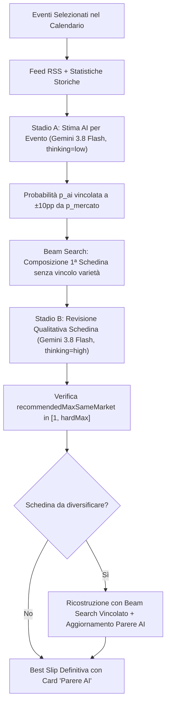

# 📋 SAMU BET — Documentazione Tecnica & Recap Totale dell'Applicazione

> **Versione**: 1.1.0 (SAMU BET v1.1 — PWA Mobile-First)  
> **Ultimo Aggiornamento**: 02 Novembre 2026  
> **Ambiente**: Node.js 20+, TypeScript 5+, Vite, React 19, Express, Vercel Serverless (`maxDuration: 60s`)  
> **Disclaimer Gioco Responsabile (18+)**: SAMU BET **non** è un bookmaker, **non** piazza scommesse, **non** gestisce transazioni in denaro e **non** è collegato ad account SNAI. È uno strumento scientifico e quantitativo di analisi statistica e supporto decisionale. Telefono Verde Nazionale Gioco d'Azzardo: **800 558 822**.

---

## 📑 Indice dei Contenuti

1. [Visione Generale e Obiettivo](#1-visione-generale-e-obiettivo)
2. [Novità Versione 1.1](#2-novità-versione-11)
3. [Architettura del Sistema & Struttura delle Cartelle](#3-architettura-del-sistema--struttura-delle-cartelle)
4. [Pipeline AI a Due Stadi (Google Gemini)](#4-pipeline-ai-a-due-stadi-google-gemini)
5. [Calendario & Filtro Competizioni / Coppe](#5-calendario--filtro-competizioni--coppe)
6. [Sistema di Varietà e Diversificazione Mercati](#6-sistema-di-varietà-e-diversificazione-mercati)
7. [Motore Matematico e Correzione Anomalie](#7-motore-matematico-e-correzione-anomalie)
8. [Fonti Dati e Stato Integrazioni (100% Free Tier)](#8-fonti-dati-e-stato-integrazioni-100-free-tier)
9. [Proposte Nuova Icona dell'Applicazione](#9-proposte-nuova-icona-dellapplicazione)
10. [Test di Accettazione e Validazione (21 Test Passati)](#10-test-di-accettazione-e-validazione-21-test-passati)
11. [Guida Operativa: Sviluppo, Esecuzione e Deploy](#11-guida-operativa-sviluppo-esecuzione-e-deploy)

---

## 1. Visione Generale e Obiettivo

**SAMU BET** nasce per colmare il divario tra l'intuizione soggettiva dello scommettitore e l'analisi quantitativa avanzata del mercato del betting. L'applicazione analizza in tempo reale le quote dei bookmaker europei, le statistiche storiche di classifica, i flussi di notizie sportive (via feed RSS) e le formazioni probabili per comporre la **miglior schedina possibile** e selezionare le singole a maggior valore atteso ($\text{EV}$).

### Parametri di Ricerca dell'Utente
- **Tipo Giocata**: *Singola* (1 evento mirato) oppure *Multipla* (da 2 a 50 eventi).
- **Quota Totale Desiderata ($Q$)**: da `1.10` fino a `3000.00` (con limite prudenziale a `30.00` per le singole).
- **Livello di Rischio ($R$)**: slider da `1` (*Molto prudente*) a `10` (*Estremo*), più il livello speciale `11` (*ULTRA 100% IA*).
- **Finestra Temporale**: *Oggi*, *48 ore*, *7 giorni*, *14 giorni* (`days14`).
- **Filtro Competizioni & Coppe**: modal dedicato con suddivisione in *Campionati*, *Coppe* e *Altro*, ricerca e selezione per nazione.
- **Varietà Mercati**: selettore *Auto (decide l'AI)*, *Alta (max 2 uguali)*, *Normale (max 3 uguali)*, *Nessun limite*.
- **Filtro Macro-Mercati SNAI**: selezione di categorie specifiche (es. Marcatori, Combo, Multigoal, Cartellini/Corner, ecc.).

---

## 2. Novità Versione 1.1

1. **Pipeline AI a 2 Stadi con Reasoning Dinamico**:
   - Stadio A (Stima Probabilità per Evento): `p_ai`, confidenza, fattori chiave, rischi, dati mancanti e fonti, con reasoning leggero (`low`).
   - Stadio B (Revisione Qualitativa della Schedina): parere d'insieme ("Parere AI"), alert di correlazione e raccomandazione varietà (`recommendedMaxSameMarket`), con reasoning approfondito (`high`). Non altera le probabilità matematiche.
2. **Catena di Fallback Modelli Gemini**:
   - Primario: `gemini-3.8-flash` (configurabile da `GEMINI_MODEL`).
   - Fallback automatico: `gemini-2.5-flash` e `gemini-2.5-flash-lite` in caso di errore di quota 429 o temporaneo 503.
   - Fallback elegante a "Solo Mercato" senza crash o numeri sintetici inventati se l'AI non è disponibile.
3. **Filtro Avanzato Competizioni e Coppe**:
   - Modal full-screen per mobile e desktop, suddiviso in *Campionati*, *Coppe* e *Altro*.
   - Raggruppamento per nazione (Italia in primo piano) e contatore partite in tempo reale per ciascuna competizione.
   - Salvataggio delle preferenze in `localStorage` ('samubet_selected_competitions').
4. **Calendario Multi-Fonte e Finestra 14 Giorni**:
   - Supporto della finestra temporale estesa a 14 giorni (`days14`) con avviso di volatilità di mercato ed eventi lontani.
   - Timestamp del calendario formattato in fuso orario di Roma (`Europe/Rome`).
   - Deduplica automatica degli eventi entro $\pm 3\text{h}$ da fonti multiple (The Odds API + Football-Data.org).
5. **Diversificazione Mercati e Distinzione Quote Modello**:
   - Tag `sourceType: 'market' | 'model'` su tutte le selezioni.
   - Le quote stimate dal modello bivariato Poisson/Dixon-Coles mostrano l'etichetta "Quota modello" e il relativo $\text{EV}$ non entra nel ranking finché l'utente non inserisce la quota reale SNAI.
   - Avviso se 3 o più selezioni condividono lo stesso mercato o modello ("Le stime condividono lo stesso modello, la probabilità reale può essere più bassa").
6. **5 Nuove Proposte Grafiche di Icona**:
   - Create con intelligenza artificiale avanzata in alta definizione 1024x1024 PNG.
   - Pagina di anteprima locale interattiva `frontend/icon-preview.html` pronta per la scelta finale dell'utente prima della sostituzione definitiva in `manifest.json`.

---

## 3. Architettura del Sistema & Struttura delle Cartelle

```
APP PRONOSTICI/
├── backend/
│   ├── src/
│   │   ├── ai/
│   │   │   └── slipReview.ts               # Stadio B: Revisione qualitativa della schedina con Gemini
│   │   ├── cache/
│   │   │   └── cacheManager.ts             # Cache memoria/disco, quota tracking e telemetry AI
│   │   ├── config/
│   │   │   ├── competitionsCatalog.ts      # Catalogo campionati/coppe mondiali e classificazione
│   │   │   ├── envCheck.ts                 # Verifica e report diagnostico variabili d'ambiente
│   │   │   └── riskConfig.ts               # Regole dei livelli di rischio (1-10 + ULTRA)
│   │   ├── engine/
│   │   │   ├── probability.ts              # Rimozione overround bookmaker (Shin/Proporzionale) e clamp ±10pp
│   │   │   └── slipBuilder.ts              # Beam search, vincolo varietà maxSameMarket e ranking EV
│   │   ├── providers/
│   │   │   ├── fixturesProvider.ts         # Provider calendario (The Odds API + Football-Data, deduplica ±3h)
│   │   │   ├── geminiProvider.ts           # Client Gemini API con catena fallback e thinking config
│   │   │   ├── oddsProvider.ts             # Fetch quote reali e generazione quote derivate SNAI
│   │   │   ├── footballStatsProvider.ts    # Statistiche e classifiche Football-Data.org
│   │   │   ├── tennisStatsProvider.ts      # Statistiche tennis
│   │   │   └── f1StatsProvider.ts          # Statistiche Formula 1 (Jolpica F1)
│   │   ├── rss/
│   │   │   └── rssService.ts               # Fetch e matching notizie sportive via feed RSS (cache 2h)
│   │   ├── types/
│   │   │   └── models.ts                   # Modelli Zod e interfacce TypeScript unificate
│   │   └── server.ts                       # API Express (/api/analyze, /api/competitions, /api/status)
│   └── tests/
│       └── acceptance.test.ts              # 21 test unitari e di accettazione completi (Vitest)
├── frontend/
│   ├── public/
│   │   ├── icon-proposals/                 # 5 proposte PNG generate (icon-1.png ... icon-5.png)
│   │   ├── manifest.json                   # Web App Manifest PWA
│   │   └── sw.js                           # Service Worker PWA per caching offline
│   ├── icon-preview.html                   # Pagina locale per visualizzare e confrontare le 5 icone
│   └── src/
│       ├── components/
│       │   ├── CompetitionsPicker.tsx      # Modal selezione Campionati / Coppe con contatori live
│       │   ├── Header.tsx                  # Header con badge modello AI attivo e link impostazioni
│       │   ├── ResultsView.tsx             # Schermata risultati (Schedina / Pronostici consigliati)
│       │   ├── SearchForm.tsx              # Form di ricerca con selettore varietà, 14 giorni e competizioni
│       │   ├── SelectionCard.tsx           # Carta pronostico con override quota SNAI e badge modello
│       │   └── SlipSummary.tsx             # Riepilogo schedina con Parere AI, KPI e download immagine HD
│       ├── engine/
│       │   ├── clientEngine.ts             # Ricalcolo istantaneo lato client delle quote e dell'EV
│       │   └── staticPagesEngine.ts        # Motore autonomo di fallback per GitHub Pages
│       └── services/
│           └── apiClient.ts                # Client API frontend verso il backend Express
├── local-ai-bridge/                        # Bridge locale Windows opzionale per modelli LLM offline
├── vercel.json                             # Configurazione deploy Vercel (maxDuration: 60s)
├── .env.example                            # Modello variabili d'ambiente documentato
├── README.md                               # Guida rapida e documentazione
└── RECAP_TOTALE_APP.md                     # Questo documento
```

---

## 4. Pipeline AI a Due Stadi (Google Gemini)



### Parametri di Configurazione AI (.env)
- `GEMINI_MODEL`: default `gemini-3.8-flash`.
- `GEMINI_FALLBACK_MODELS`: `gemini-2.5-flash,gemini-2.5-flash-lite`.
- `GEMINI_THINKING_LEVEL_ESTIMATE`: `low` (analisi rapida di 8-24 partite).
- `GEMINI_THINKING_LEVEL_REVIEW`: `high` (analisi qualitativa d'insieme della schedina finale).
- `GROUNDING_ENABLED`: `false` di default sul piano gratuito (il tool search lancia 429 su progetti non fatturati; i feed RSS fungono da fonte informativa primaria in tempo reale).
- `GROUNDING_MONTHLY_BUDGET`: soglia di sicurezza a 4000 chiamate/mese.

---

## 5. Calendario & Filtro Competizioni / Coppe

- **Endpoint**: `GET /api/competitions?timeWindow=hours48`
- **Provider Calendario**: `CompositeFixturesProvider` interroga prima The Odds API (`/v4/sports/soccer/events`, 0 crediti consumati) e Football-Data.org (`/v4/matches`).
- **Deduplica Temporale**: eventi con squadre corrispondenti e orario entro $\pm 3\text{h}$ vengono fusi in un unico evento unificato.
- **Timestamp e Fuso Orario**: visualizzazione orari e ultimo aggiornamento calendario rigorosamente in formato italiano con fuso di Roma (`Europe/Rome`).
- **Filtro Modal Frontend**:
  - Tab *Campionati* (Serie A, Premier, Liga, Bundesliga, Ligue 1, Brasileirao, MLS, ecc.).
  - Tab *Coppe* (Champions League, Europa League, Conference, Coppa Italia, FA Cup, Copa del Rey, Libertadores, ecc.).
  - Tab *Altro* (Qualificazioni mondiali, tornei amichevoli e speciali).
  - Filtro rapido *Solo Italia*, *Seleziona Tutti*, *Deseleziona Tutti*.
  - Persistenza in `localStorage`.

---

## 6. Sistema di Varietà e Diversificazione Mercati

1. **Problema Risolto (Clustering dei Mercati)**: in precedenza, l'ottimizzatore tendeva a concentrare le selezioni su mercati identici (es. tutte Under/Over 2.5 o tutte 1X2), aumentando la correlazione del rischio in multipla.
2. **Classificazione Quote**:
   - `sourceType: 'market'`: quote reali raccolte dai bookmaker (1X2, Over/Under 2.5, Handicap).
   - `sourceType: 'model'`: quote generate internamente tramite modello bivariato Poisson/Dixon-Coles (Combo, Multigoal, Marcatori, Parziale/Finale). L'$\text{EV}$ di queste selezioni è escluso dal punteggio finché l'utente non inserisce la quota reale SNAI.
3. **Limiti di Varietà**:
   - `Auto (consigliata AI)`: l'AI propone `recommendedMaxSameMarket`, validato nel range $[1, \max(2, \lceil N/2 \rceil)]$. Ripiego deterministico su `3` se l'AI è offline.
   - `Alta`: massimo 2 selezioni dello stesso mercato.
   - `Normale`: massimo 3 selezioni dello stesso mercato.
   - `Nessun Limite`: combinazione puramente matematica libera.
4. **Avviso Stesso Modello**: se 3 o più selezioni condividono lo stesso mercato, viene mostrato l'avviso di prudenza: *"Le stime condividono lo stesso modello o mercato, la probabilità reale può essere più bassa"*.

---

## 7. Motore Matematico e Correzione Anomalie

Nel corso dell'aggiornamento sono state identificate e corrette 3 anomalie probabilistiche:

1. **Rimozione del Boost Artificiale di Probabilità nelle Multiple**:
   - *Prima*: `pFinal = Math.max(riskRule.minProb, rawPFinal)` forzava la probabilità finale a salire fino alla soglia del rischio, falsificando l'$\text{EV}$ reale.
   - *Adesso*: si utilizza direttamente `rawPFinal` senza alterazioni artificiali.
2. **Applicazione del Clamp $\pm 10\text{pp}$ in Modalità ULTRA (Rischio 11)**:
   - *Prima*: il blending ponderava `0.35 * pMarket + 0.65 * directEst.p_ai` senza clamp, esponendo a stime estreme o allucinate.
   - *Adesso*: $p_{ai}$ viene vincolato rigorosamente nell'intervallo $[p_{market} - 0.10, p_{market} + 0.10]$ prima di applicare il peso dell'AI.
3. **Fallback Pulito Solo-Mercato**:
   - *Prima*: la mancata risposta dell'AI generava numeri sintetici o escludeva tutti i candidati.
   - *Adesso*: il sistema degrada in modalità `market_only` con probabilità depurate dal margine del bookmaker, badge dedicato e zero crash.

---

## 8. Fonti Dati e Stato Integrazioni (100% Free Tier)

| Servizio | Scopo | Limite Free Tier | Stato |
| :--- | :--- | :--- | :--- |
| **The Odds API** | Quote reali 1X2, Under/Over, Handicap e Calendario eventi | 500 crediti/mese (eventi = 0 crediti) | ✅ Attivo e Funzionante |
| **Football-Data.org** | Calendario, classifiche e statistiche 12 campionati top | 10 req/min (gratuito senza carta) | ✅ Attivo e Funzionante |
| **Google Gemini API** | Stima qualitativa Stadio A + Revisione Stadio B | 15 RPM free tier Google AI Studio | ✅ Attivo (`gemini-3.8-flash`) |
| **Jolpica F1 API** | Calendario e classifiche Formula 1 | Illimitato / Open Source | ✅ Attivo e Funzionante |
| **Feed RSS Sportivi** | Notizie in tempo reale per matching infortuni e formazioni | Illimitato (cache 2 ore) | ✅ Attivo (Gazzetta, BBC, Sky) |
| **OneFootball** | Calendario e formazioni alternative | N/A (Termini d'uso proibiscono scraping non autorizzato) | ❌ Non implementato (rispetto ToS) |

---

## 9. Icona Ufficiale dell'Applicazione PWA

Tra le 5 proposte generate in alta definizione (1024x1024 PNG), è stata scelta e attivata come icona ufficiale della PWA la **Proposta 4**:

- **Concept**: *The Athletic Tech "S"*
- **Design**: Lettera "S" audace, atletica e geometrica, formata da due lame angolari sfaccettate in bianco puro (#FFFFFF) e verde lime sportivo (#22c55e) su sfondo scuro opaco (#0f172a).
- **Risoluzioni PWA generate e attive**:
  - `icon-192.png` (192x192, formato PWA standard per Android, scopi `any` e `maskable`)
  - `icon-512.png` (512x512, formato splash screen HD e installazione PWA, scopi `any` e `maskable`)
  - `apple-touch-icon.png` (180x180, icona schermata Home per iOS / iPadOS)
  - `favicon.png` (48x48, visualizzazione tab del browser)
- **File di configurazione aggiornati**:
  - [manifest.json](file:///c:/Users/utente/Desktop/APP%20PRONOSTICI/frontend/public/manifest.json) con scopi `any` e `maskable`
  - [index.html](file:///c:/Users/utente/Desktop/APP%20PRONOSTICI/frontend/index.html) con `<link rel="icon">` e `<link rel="apple-touch-icon">`
  - [sw.js](file:///c:/Users/utente/Desktop/APP%20PRONOSTICI/frontend/public/sw.js) cache PWA v3 aggiornata con i file PNG
  - Rimossi tutti i vecchi file SVG obsoleti (`icon-192.svg`, `icon-512.svg`).

---

## 10. Test di Accettazione e Validazione (21 Test Passati)

Tutti i 21 test unitari e di accettazione sono verificati con successo:

```powershell
npm.cmd test
```

### Esito Test Suite (Vitest)
```
✓ tests/acceptance.test.ts (21 tests)
  ✓ Test 1: Q=6, N=3, R=5 -> g≈1.82 è fattibile: 3 selezioni, prodotto quote in [5.52, 6.48]
  ✓ Test 2: Q=20, N=2, R=2 -> incoerente: avviso e proposta N_min = 9
  ✓ Test 3: Q=1.5, N=10 -> g < 1.05: avviso e proposta di ridurre N
  ✓ Test 4: Nessun evento nella finestra scelta -> risultato null pulito senza crash
  ✓ Test 5, 5b, 5c: Fallback solo mercato, clamp ±10% di p_ai e gestione risultati parziali
  ✓ Test 5d: Il local-ai-bridge rifiuta richieste senza token (401) o da origini non consentite (403)
  ✓ Test 6: Modifica di "Quota SNAI reale" -> ricalcolo immediato di EV e probabilità combinata
  ✓ Test 7: Mai due selezioni dello stesso evento nella stessa schedina
  ✓ Test 8: Chiavi API assenti dal bundle del frontend e assenza di parole vietate ("garantito", "vincita certa")
  ✓ Test 9: Singola vs Multipla (Max 50 partite, Quota Max 3000) con calcolo automatico di N
  ✓ Scenario 1: Con data simulata 02/11/2026 esclude partite passate in Europe/Rome e mostra timestamp
  ✓ Scenario 2: Filtro solo coppe -> solo partite di tipo cup
  ✓ Scenario 3: Finestra 14 giorni (days14) accettata da schema e calcolo temporale corretto
  ✓ Scenario 4: Fallback provider non disponibile -> catena di fallback pulita
  ✓ Scenario 5: Deduplica partite entro ±3h -> unifica sorgenti
  ✓ Scenario 6: Fallback graceful su market_only se AI offline
  ✓ Scenario 7: Clamp ±10pp invariato
  ✓ Scenario 8: Varietà Auto valida raccomandazione in [1, hardMax] e limite manuale prevale
  ✓ Scenario 9: La revisione della schedina (Stadio B) non altera le probabilità pFinal
  ✓ Scenario 10: slipReview con JSON non valido viene respinto da Zod senza errori
  ✓ Scenario 11: Le 5 proposte di icone PNG sono presenti in frontend/public/icon-proposals/ e icon-preview.html esiste
```

---

## 11. Guida Operativa: Sviluppo, Esecuzione e Deploy

### 1. Installazione e Avvio Locale
```powershell
# Installa tutte le dipendenze
npm.cmd run install:all

# Compilazione backend e frontend
npm.cmd run build

# Esecuzione test di accettazione
npm.cmd test

# Avvio server di sviluppo
npm.cmd run dev:backend    # Porta 3001
npm.cmd run dev:frontend   # Porta 5173
```

### 2. Deploy su Vercel
L'applicazione è pronta per il deploy serverless su Vercel. Il file `vercel.json` estende `maxDuration: 60` secondi per consentire a Gemini di completare il reasoning senza interruzioni di timeout.
Per distribuire:
```powershell
vercel --prod
```
Impostare su Vercel le variabili d'ambiente:
- `THE_ODDS_API_KEY`
- `FOOTBALL_DATA_API_KEY`
- `GEMINI_API_KEY`
- `GEMINI_MODEL=gemini-3.8-flash`
